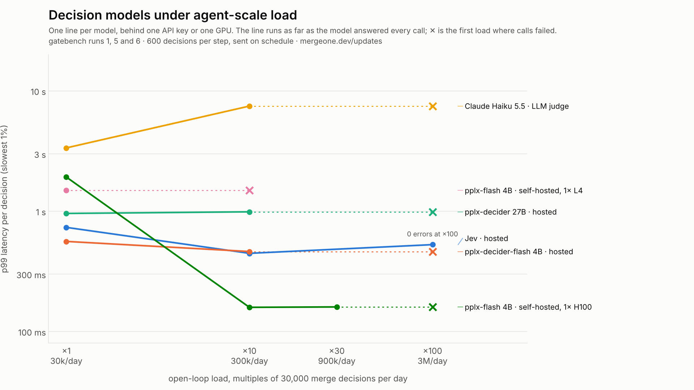

<p align="center">
  
</p>

<h1 align="center">mergeone</h1>

<p align="center"><b>One decision per merge, at swarm scale.</b><br>
<sub>An open-source merge gateway for repositories where agents write most of the commits — and the pre-registered benchmark that says what it can and cannot do.</sub></p>

<p align="center">
  <a href="https://github.com/haalp/mergeone/actions/workflows/ci.yml"></a>
  <a href="https://github.com/haalp/mergeone/releases"></a>
  
  <a href="LICENSE"></a>
  <a href="https://mergeone.dev/updates/"></a>
</p>

When most commits are written by agents, the merge queue is the bottleneck. **mergeone** puts one fast, typed decision in front of trunk: a small decision model answers a fixed set of questions about each pull request with calibrated probabilities in one ~300 ms call, a policy file you own turns them into `pass` / `hold` / `block`, and every verdict is logged with its exact input. One Go binary; works as a CI step, a GitHub webhook, or an MCP server the agent calls before it merges.

It is also a benchmark. Every claim here was pre-registered in [`PROTOCOL.md`](PROTOCOL.md) before the data existed; three of six runs failed and are reported anyway.

## How a PR flows through it

```
                 ┌─────────────────────────────── mergeone ───────────────────────────────┐
  PR opened      │  render once      decision model        calibrate        .mergeone.yaml │   verdict + route
  (agent / CI) ─▶│  diff + message ─▶ ~10 typed questions ─▶ isotonic maps ─▶ rules, first  │─▶ pass   → auto-merge
                 │  + PR memory       one call, ~300 ms      0.6 = 60%        match wins    │   hold   → human / dedup
                 │                                                                          │   block  → stop
                 └──────────────────────────────────┬───────────────────────────────────────┘
                                                    └─▶ gatelog: every verdict, its input, its hash
```

The model never sees a rule and never writes prose. It returns probabilities for questions like `is_logic_change`, `weakens_tests`, `needs_human_review`, `hard_to_revert`, and — when PR memory is on — `duplicate_of` an existing PR. The policy is the only thing you edit.

## Start

```bash
curl -fsSL https://mergeone.dev/install.sh | sh     # one static binary (or: go install github.com/haalp/mergeone/gate/cmd/mergeone@latest)
cd your-repo
mergeone init                                        # writes .mergeone.yaml, checks keys, prints next steps
export TYPESAFE_API_KEY=...                          # the default model; `mergeone init --model pplx-flash|haiku|local` for others
mergeone pr --policy .mergeone.yaml --base origin/main --head HEAD
```

```json
{ "verdict": "hold", "route": "human", "rule": "message-mismatch",
  "reason": "Message does not explain the behavioural change in the diff",
  "probs": { "is_logic_change": 0.93, "weakens_tests": 0.05, "message_matches_diff": 0.31,
             "touches_concurrency": 0.12, "needs_human_review": 0.58 },
  "model_version": "jev-1.13.0", "latency_ms": 318, "cost_usd": 0.00007 }
```

Exit code 0 = pass, 1 = hold, 2 = block. No key yet? `mergeone serve --mock` runs the whole pipeline with a stand-in model, and `mergeone replay` dry-runs your policy over 1,200 real PRs shipped in the repo.

`mergeone init --all` also writes a GitHub Actions workflow and the MCP snippet for `CLAUDE.md`.

Just `mergeone` opens a session with the same commands inside.

## Three ways to run it

| mode | command | what happens |
|---|---|---|
| **CI step** | `mergeone pr` in a workflow | one verdict per PR head; exit code gates the job. With [verdict actions](#policy) on: commit status, `mergeone:*` label, one comment, reviewers. |
| **Webhook** | `mergeone serve --policy .mergeone.yaml` + GitHub `pull_request` webhook | the same decision, server-side, idempotent per head SHA; HTTP API for `/decide`, `/verdict`, `/plan`, `/stats`. |
| **Agent (MCP)** | `claude mcp add mergeone -- mergeone mcp --policy .mergeone.yaml` | the agent calls `gate_decide` *before* merging and merges only on `pass`. The MCP tools never write to GitHub. |

```
# CLAUDE.md
Before merging, call gate_decide with repo_path="." base="main" head="HEAD".
Merge only on "pass". On "hold" or "block", open a PR and request the route named.
```

## Policy

`.mergeone.yaml` is the whole product surface: which model (`model: jev` — any row of [`prompts/models.yaml`](prompts/models.yaml), hosted or self-hosted), which question set, paths that always need a human, whether PR memory is on, the rules, and what to write back to the PR.

```yaml
model: jev                     # or pplx-flash, haiku, local, … — one YAML row, no code
question_set: v2
always_human_paths: ["migrations/", "auth/"]
memory: { enabled: false, top_k: 5 }   # opt-in: asks whether the PR duplicates a recent one
rules:
  - { name: weakens-tests, when: { weakens_tests: ">= 0.6" }, verdict: block, route: human }
  - { name: needs-human,   when: { needs_human_review: ">= 0.5" }, verdict: hold,  route: human }
  - { name: duplicate-of,  when: { duplicate_of: ">= 0.7" },  verdict: hold,  route: dedup }
default: { verdict: pass, route: auto-merge }
on_error: { verdict: hold, route: human }      # fail closed
actions:                       # webhook / CI mode only; off by default; never merges
  enabled: false
  on_pass:  { status: success, labels: ["mergeone:pass"] }
  on_hold:  { status: failure, labels: ["mergeone:hold"], reviewers: [] }
  on_block: { status: failure, labels: ["mergeone:block"] }
```

Rules run top to bottom on *calibrated* probabilities; first match wins; a model outage holds the PR for a human. Verdict actions are deterministic GitHub calls — commit status for branch protection, exclusive labels, one comment per head SHA with the typed reasons, reviewers on `hold`/`block` routed to a human — and they never change a verdict. Least-privilege token: statuses, pull requests and issues write. Full reference: [`docs/POLICY.md`](docs/POLICY.md).

## What it costs, what it carries

The gateway itself adds single-digit milliseconds: 350 decisions/s on one 2-vCPU box at p99 441 ms with a mock model, re-proved by CI on every push. The model you plug in sets the real ceiling — measured, not quoted:



*One line per decision model behind one API key or one GPU; the line runs as far as every call was answered, ✕ is the first load with failures. Only the hosted System One model reaches 100× (3M decisions/day) clean; one H100 is the fastest row and stops at 30×. Rebuilt from the frozen load-test files by `scripts/fig_decision_models_under_load.py`.*

## Evidence

Six pre-registered runs. Hypotheses and thresholds were committed before any model call; deviations are dated in [`CHANGELOG.md`](CHANGELOG.md); every table rebuilds with one command from `results/run*`.

| run | question | result |
|---|---|---|
| 1 | Can a diff predict a 30-day revert? | ❌ PR-AUC 0.010 vs base 0.0075 — nothing in the diff |
| 2 | Can a System One model answer typed triage questions? | ✅ ROC-AUC 0.87–0.96 vs a strong judge, 347 ms, $0.074/1k |
| 3 | Does the gate predict rejection of real agent PRs? | ❌ 0.55 (bar 0.70): 67% of closures are coordination, not quality |
| 4 | Can a PR memory catch the duplicates? | 🟡 `same_change` 0.83–0.87 (bar 0.80) ✅ · retrieval recall@5 0.55 (bar 0.60) ❌ |
| 5 | Does a flag mean more review? | 🟡 flag ⇒ ≥ 2 review rounds AUC 0.76 (bar 0.70) ✅ · retrieval 0.66 (bar 0.70) ❌ · store p99 3.3 ms ✅ |
| 6A | Do self-hosted open weights clear the scale bar? | ❌ one H100: 30× at 160 ms, 100× fails; batching changes nothing. Part B (hold precision, two blind labellers) in progress |

What survives: typed triage of *what a change does* at System One speed and cost; a gateway that is never the bottleneck; a cheap model can tell two PRs are the same change. What does not: predicting what a project will *accept* from one diff, and — so far — finding the right PR to compare against. Full write-ups: [`docs/EVIDENCE.md`](docs/EVIDENCE.md), per run `results/run*/README.md`, model ranking [`results/leaderboard.md`](results/leaderboard.md), dated short versions at [mergeone.dev/updates](https://mergeone.dev/updates/).

## Limits, plainly

- The gate judges what a change *does*, not whether a project will *take* it. Most agent-PR rejections are coordination (duplicates, superseded, direction); PR memory addresses part of that and is still opt-in.
- Run 2's ground truth is a model's judgement, audited for self-consistency, not by hand; run 3's labels are real GitHub outcomes.
- The default model is a hosted API in early access; pricing may change. The model is one config line.
- GitHub only, for now.

## Layout

```
gate/            Go: the mergeone binary (init, pr, serve, decide, replay, loadtest, index, mcp, models)
mergeone/        Python: gatebench (extraction, judge, calibration, reports) + reference gateway
prompts/         frozen question sets, prompts and the decision-model registry (models.yaml)
serve/           self-hosting an open-weight decision model behind /v1/systemone (run 6)
results/run*/    raw predictions, labels, metrics, figures · results/leaderboard.md
PROTOCOL.md      pre-registered protocol · CHANGELOG.md every deviation, with reason · ROADMAP.md
```

Apache-2.0 · Hasan Alp Temiz · [mergeone.dev](https://mergeone.dev)
