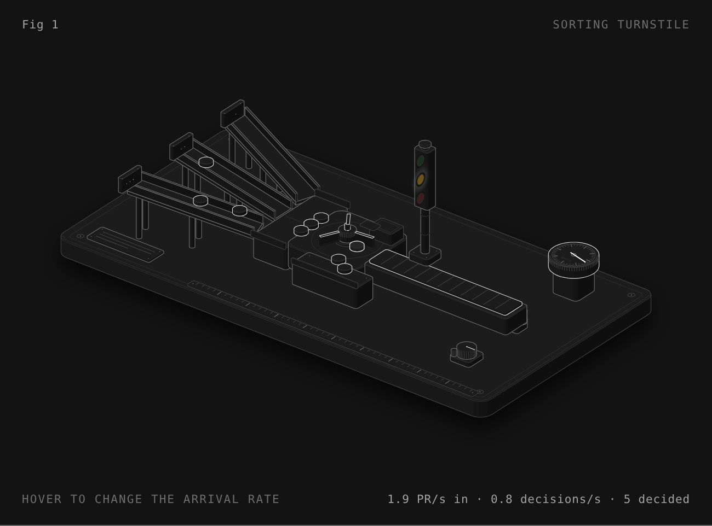

<p align="center">
  
</p>

<h1 align="center">mergeone</h1>

<p align="center"><b>One decision per merge, at swarm scale.</b><br>
<sub>An open-source merge gateway for repositories where agents write most of the commits — and the pre-registered study that says what it can and cannot do.</sub></p>

<p align="center">
  <a href="https://github.com/haalp/mergeone/actions/workflows/ci.yml"></a>
  <a href="https://github.com/haalp/mergeone/releases"></a>
  
  
  <a href="LICENSE"></a>
  <a href="https://mergeone.dev"></a>
</p>

<p align="center">
  
</p>

Anthropic's monorepo went from 2,500 to **30,000 merges a day**, almost all agent-written, and they rebuilt source control to cope ([Redesigning source control](https://www.anthropic.com/engineering/redesigning-source-control)). Their post is about storage. It leaves the harder question open: **at that rate, who decides what merges?**

`mergeone` is an attempt at the answer: a small, fast, *typed* decision layer in front of trunk. A System One model answers five fixed questions per PR with calibrated probabilities in one ~300 ms call; a policy file you own turns them into `pass` / `hold` / `block`; a planner lands non-conflicting PRs in waves. It ships as one Go binary with a GitHub webhook, an HTTP API and an MCP server for agents.

It is also a benchmark. Every claim below was pre-registered in [`PROTOCOL.md`](PROTOCOL.md) before the data existed, and **two of the four runs failed**. They are reported anyway.

## Scoreboard

| run | question | result | number |
|---|---|---|---|
| 1 | Can a diff predict a 30-day revert? | ❌ negative | PR-AUC 0.010 vs base 0.0075, all four systems |
| 2 | Can a System One model answer typed triage questions? | ✅ positive | ROC-AUC 0.87–0.96 vs a strong judge, 347 ms, $0.074/1k — bar met 5/5 (Jev), 4/5 (Haiku) |
| 3 | Does the gate predict rejection of **real agent PRs**? | ❌ negative | ROC-AUC 0.55 (bar 0.70). 67% of closures are superseded/duplicate/direction — not visible in a diff. Volume: Jev p99 417 ms, 0 errors at 100× |
| 4 | Can a per-repo PR memory catch the duplicates? | 🟡 in progress | pre-registered 2026-10-17; labels are maintainer comments, not a model |

What survives: typed triage of *what a change does* at System One speed and cost, and a gateway that handles 30 million decisions a day on a 2-vCPU box. What does not: predicting what a project will *accept* from one diff. Details in [`results/`](results/) and on [mergeone.dev](https://mergeone.dev).

```
PR ──▶ decision model ──▶ calibrated probabilities ──▶ .mergeone.yaml ──▶ verdict + route
       Jev / Haiku          is_logic_change      0.91    weakens_tests >= 0.6 → block     pass · hold · block
       ~300 ms, $0.00007    weakens_tests        0.07    needs_human    >= 0.5 → hold     auto-merge · human · dedup
                            message_matches_diff 0.88    duplicate_of   >= 0.7 → hold
                            touches_concurrency  0.63                  └─▶ gatelog: every verdict + its exact input
                            needs_human_review   0.41
```

## 60 seconds

```bash
curl -fsSL https://mergeone.dev/install.sh | sh          # one static binary; or: go install github.com/haalp/mergeone/gate/cmd/mergeone@latest
export TYPESAFE_API_KEY=...                                # Jev. Or model: haiku + ANTHROPIC_API_KEY
cp ~/.mergeone/policy.yaml .mergeone.yaml
mergeone pr --policy .mergeone.yaml --base origin/main --head HEAD
```

```json
{ "verdict": "hold", "route": "human", "rule": "message-mismatch",
  "reason": "Message does not explain the behavioural change in the diff",
  "probs": { "is_logic_change": 0.93, "weakens_tests": 0.05, "message_matches_diff": 0.31,
             "touches_concurrency": 0.12, "needs_human_review": 0.58 },
  "model_version": "jev-1.13.0", "latency_ms": 318, "cost_usd": 0.00007 }
```

Exit 0 = pass, 1 = hold, 2 = block. Drop it into any CI; `examples/github-action.yml` labels PRs `gate:<verdict>` / `route:<route>`.

No API key yet? `mergeone serve --mock` runs the whole pipeline with a deterministic stand-in model, and `mergeone replay` dry-runs your policy over 1,200 real Kubernetes PRs shipped in the repo, so you can tune thresholds before a single real decision.

## What you get

| | |
|---|---|
| **Typed, not prose** | The model returns probabilities, not a review comment. A rule is one line of YAML. First match wins. |
| **Calibrated** | `0.6` means sixty percent. Isotonic maps fitted on labelled history ship with the binary (raw ECE 0.17 → 0.03). |
| **Fail closed** | Model down, timeout, panic: the PR holds for a human. Never a silent pass. |
| **Auditable** | System One models give no rationale, so every verdict is logged with its exact input and hash. `mergeone stats` reads it back. |
| **Agent-native** | It is an MCP server. The agent calls `gate_decide` *before* merging. `claude mcp add mergeone -- mergeone mcp` |
| **Swarm-aware** | `/plan` turns hundreds of open PRs into waves that land in parallel, with file and semantic conflicts as edges. Not a queue. |
| **Built for the volume** | 350 decisions/s on one 2-vCPU box, p99 441 ms, 67 MB RSS, zero errors. CI re-proves it on every push. |

## Serve it

```bash
export GITHUB_TOKEN=... MERGEONE_WEBHOOK_SECRET=...
mergeone serve --policy .mergeone.yaml --workers 16 --addr :8787
# GitHub webhook (pull_request) → https://<host>/webhook/github
```

Each PR head gets one idempotent decision, a check-run (`success` / `neutral` / `failure`), two labels, and a line in the gatelog.

```bash
curl -X POST :8787/decide -d '{"repo":"acme/x","head_sha":"…","state":"<rendered PR>","paths":["pkg/a.go"]}'
curl :8787/verdict/acme/x/<sha>
curl :8787/plan/acme/x?semantic=true
curl :8787/stats?window=3600
```

| load (open-loop, mock 300 ms model, 2-vCPU GitHub runner) | decisions/s | p50 | p99 | errors |
|---|---|---|---|---|
| 100× Anthropic's volume · 3M/day | 35 | 304 ms | 436 ms | 0 |
| 1000× · 30M/day | 350 | 303 ms | 441 ms | 0 |

The gateway adds single-digit milliseconds; the rest is the model. With Jev the model itself held 35/s at p99 527 ms against the real API.

## The agent asks before it merges

```bash
claude mcp add mergeone -- mergeone mcp --policy .mergeone.yaml
```

```
# CLAUDE.md
Before merging, call gate_decide with repo_path="." base="main" head="HEAD".
Merge only on "pass". On "hold" or "block", open a PR and request the route named.
```

Tools: `gate_decide`, `gate_verdict`, `gate_plan`, `gate_stats`. Same calls over HTTP for everything that is not an MCP client.

## Evidence, including what did not work

Everything above rests on **gatebench**, a pre-registered benchmark: hypotheses and thresholds were committed before any model ran ([PROTOCOL.md](PROTOCOL.md)), and results are published whichever way they fall. 40,000 Kubernetes merges, four systems, two runs so far.

**Run 1, negative.** *Can a cheap decision layer predict 30-day reverts from a pre-merge diff?* No. Rules, LightGBM, Claude Haiku 5.5 and Jev all land at PR-AUC ≈ 0.010 against a 0.0075 base rate, indistinguishable within CIs. That signal is not in the diff. We did not build a product on it.

**Run 2, positive.** *Can it answer rule-like questions that cannot be written as rules?* Yes. Against a Sonnet 5.5 judge (self-agreement 92–100%) on 1,200 PRs:

| question | Jev AUC | Haiku AUC | Jev ECE (cal.) | Haiku ECE (cal.) |
|---|---|---|---|---|
| is_logic_change | 0.94 | 0.95 | 0.030 | 0.027 |
| weakens_tests | 0.96 | 0.96 | 0.031 | 0.009 |
| message_matches_diff | **0.80** | 0.78 | 0.037 | 0.045 |
| touches_concurrency | 0.95 | 0.96 | 0.016 | 0.017 |
| needs_human_review | 0.87 | 0.88 | 0.047 | 0.041 |
| per PR, five questions | **347 ms · $0.074/1k** | 1067 ms · $0.314/1k | | |

Jev meets the pre-registered bar on 5/5 questions, Haiku on 4/5; asking five questions instead of one costs Jev 3% latency and 12% cost. What still fails: routing the top 25% to humans captures only 44% of the judge's "needs a human" PRs (bar was 70%). That number is in the README on purpose.

**Run 3, negative.** *Does the gate predict whether humans reject real agent PRs?* No. On 2,196 PRs by Copilot, Claude Code, Claude, Devin and Cursor across 26 public repos (held-out test: 705 PRs, 8 repos), calibrated `needs_human_review` → *closed-unmerged ∨ change-requested* scores ROC-AUC **0.55** for Jev, 0.55 for Haiku, 0.53 for rules; the pre-registered bar was 0.70. The reason is in the labels: of 200 closures we classified, 67% were *superseded, duplicate or direction* and only 19% *quality*. A diff cannot tell you someone else already landed the fix. Two things did hold: Jev at 100× agent-scale load — p99 417 ms, 0 errors (Haiku: 2,880 ms, 0.3% errors) — and, exploratory only, the questions track *review iteration* (force-pushes ≥ 2) at AUC 0.70–0.81. Full write-up: [`results/run3/README.md`](results/run3/README.md).

Raw predictions, judge labels, calibration maps and figures: `results/run1`, `results/run2`, `results/run3`. Rebuild every table with one command.

## Limits, plainly

- The gate judges *what a change does*, not whether a project will take it. Run 3 shows most agent-PR rejections are coordination (duplicates, superseded, direction), which reading one diff cannot detect; that is what `assumptions` and campaign dedup on the roadmap are for.
- Run 2's ground truth is a model's judgement, audited for self-consistency, not yet by hand. Run 3's labels are GitHub outcomes, which are real but mostly about coordination.
- Jev is a closed API in early access; pricing may change. Haiku works today; the model is a config line.
- GitHub only, for now. Stack-level verdicts (block below ⇒ hold above) are implemented in the planner but could not be evaluated: the REST API exposes no stack object (run 3, R3-H4).

## Layout

```
gate/            Go: the mergeone binary (serve, pr, decide, replay, loadtest, mcp)
mergeone/        Python: gatebench (extraction, judge, calibration, reports) + reference gateway
prompts/         frozen question sets and prompts (jev_v2.json, haiku_v2.md, judge_v1.md)
results/run*/    raw predictions, labels, metrics, figures
PROTOCOL.md      pre-registered protocol · CHANGELOG.md every deviation, with reason
```

Apache-2.0 · Hasan Alp Temiz · built with Claude as a pair programmer · [mergeone.dev](https://mergeone.dev)

## Roadmap

See [ROADMAP.md](ROADMAP.md) — next: run3 on real agent PRs, then agent-declared `assumptions` and conflict-proving tests.
